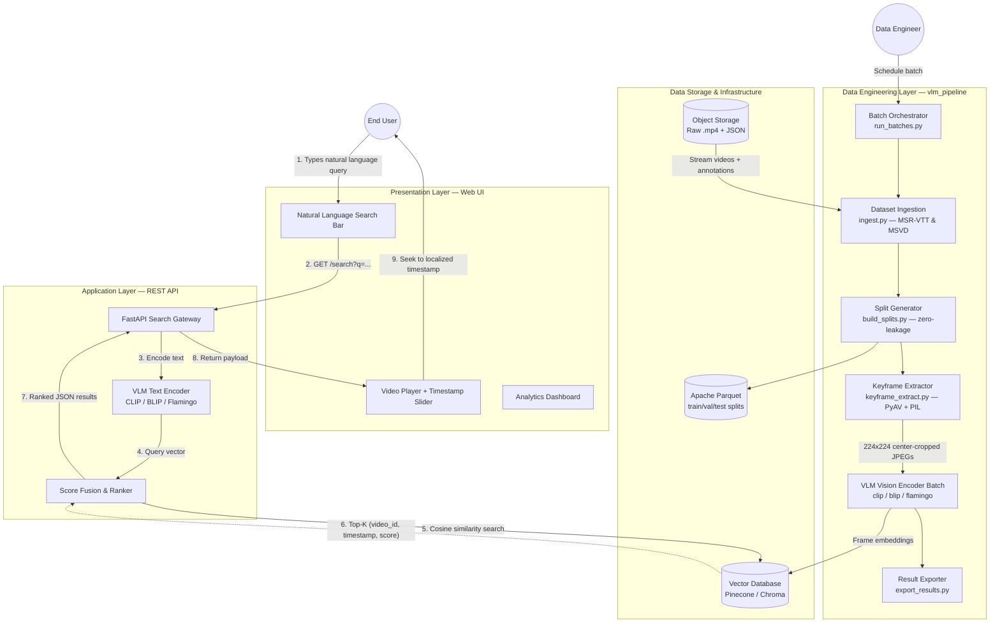
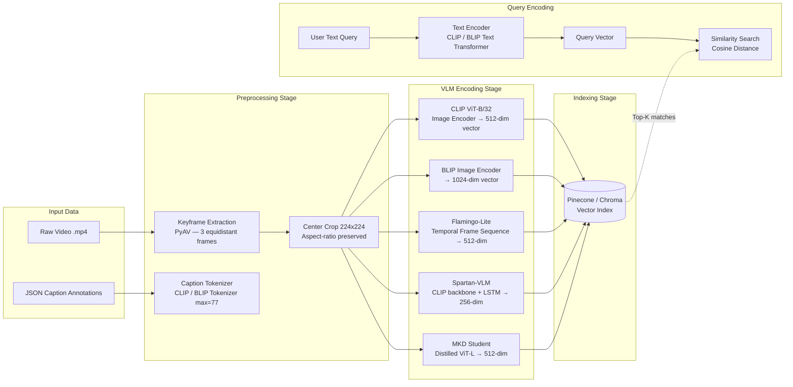
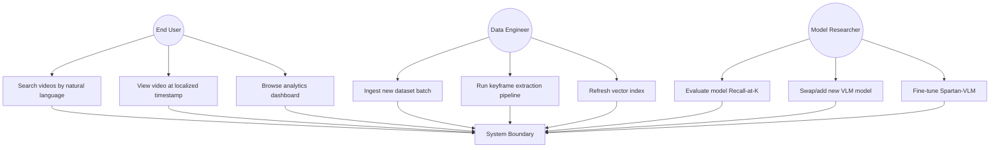
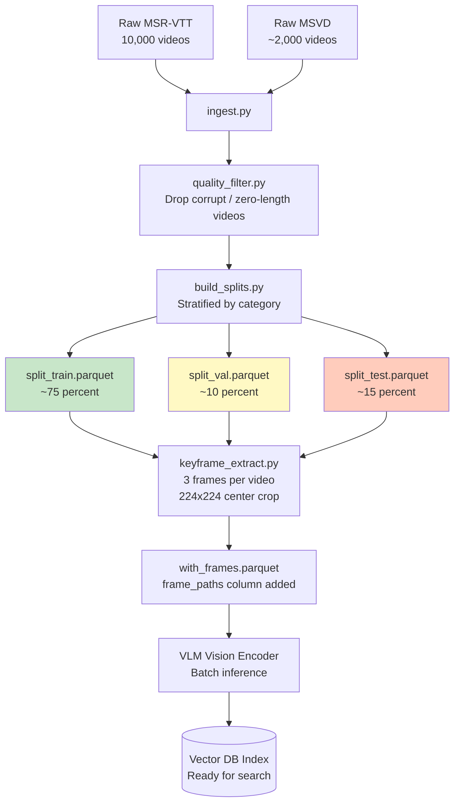
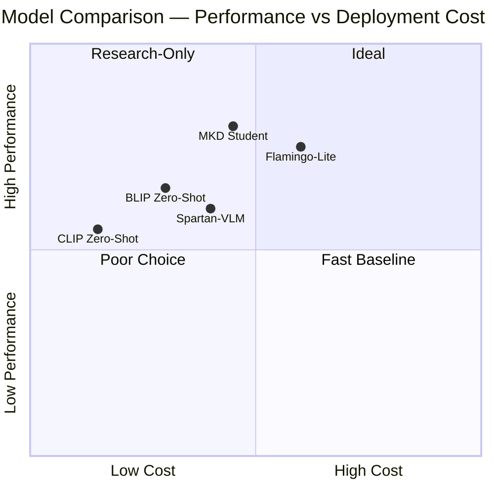

# System Architecture & Design: Zero-Shot Video & Event Search

---

## 1. Overall System Architecture (Workbook 5.2 — System Design)

---

## 2. Machine Learning Data Flow (Workbook 4.2 — Model Supports)

---

## 3. Use Case Diagram (Workbook 5.1 — System Requirements)

---

## 4. Data Pipeline Detail (Demo — Data Pre-Processing & Training/Test Splits)

---

## 5. Model Proposals Summary (Workbook 4.1)

| # | Model | Architecture | Key Feature | Evaluation Metrics |
|---|-------|-------------|-------------|-------------------|
| 1 | **CLIP Zero-Shot** | ViT-B/32 Image + Text Transformer | No training needed | R@1, R@5, R@10, Median Rank |
| 2 | **BLIP Zero-Shot** | Vision-Language Encoder-Decoder | Richer caption semantics | R@K + Caption BLEU |
| 3 | **Flamingo-Lite** | Cross-modal Temporal Transformer | 3-frame temporal reasoning | R@K + Temporal IoU |
| 4 | **Spartan-VLM** | CLIP backbone + LSTM | Lightweight fine-tunable hybrid | R@K + Fine-tune Loss |
| 5 | **MKD (Distilled)** | Teacher→Student Knowledge Distillation | Near-SOTA, deployable size | R@K + KL Divergence + Latency |

---

## 6. Model Comparison (Workbook 4.3)

---

## 7. System Support Environment (Workbook 5.4)

| Layer | Technology | Purpose |
|-------|-----------|---------|
| Language | Python 3.11 | All pipeline and API code |
| Deep Learning | PyTorch 2.3, torchvision | Model inference and training |
| VLM Models | HuggingFace transformers, OpenAI CLIP | Pre-trained model weights |
| Video Decoding | PyAV (FFmpeg bindings) | Lossless keyframe extraction |
| Image Processing | Pillow (PIL) | Resize, crop, JPEG save |
| Data Storage | Apache Parquet, Pandas | Columnar metadata storage |
| Vector Database | Pinecone / Chroma | Embedding similarity search |
| API Framework | FastAPI 0.109 | REST search endpoint |
| Frontend | React 18 + Vite | User search interface |
| Containerisation | Docker + Docker Compose | Reproducible environments |
| CI/CD | GitHub Actions | Automated testing and lint |
| Monitoring | Prometheus + Grafana | GPU/CPU and latency metrics |
| Version Control | Git (GitHub) | Collaborative development |
